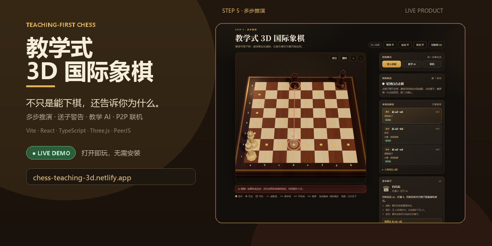
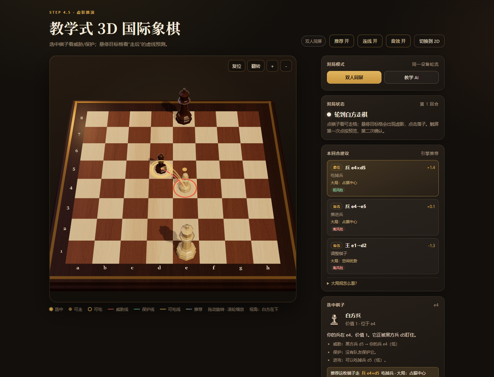
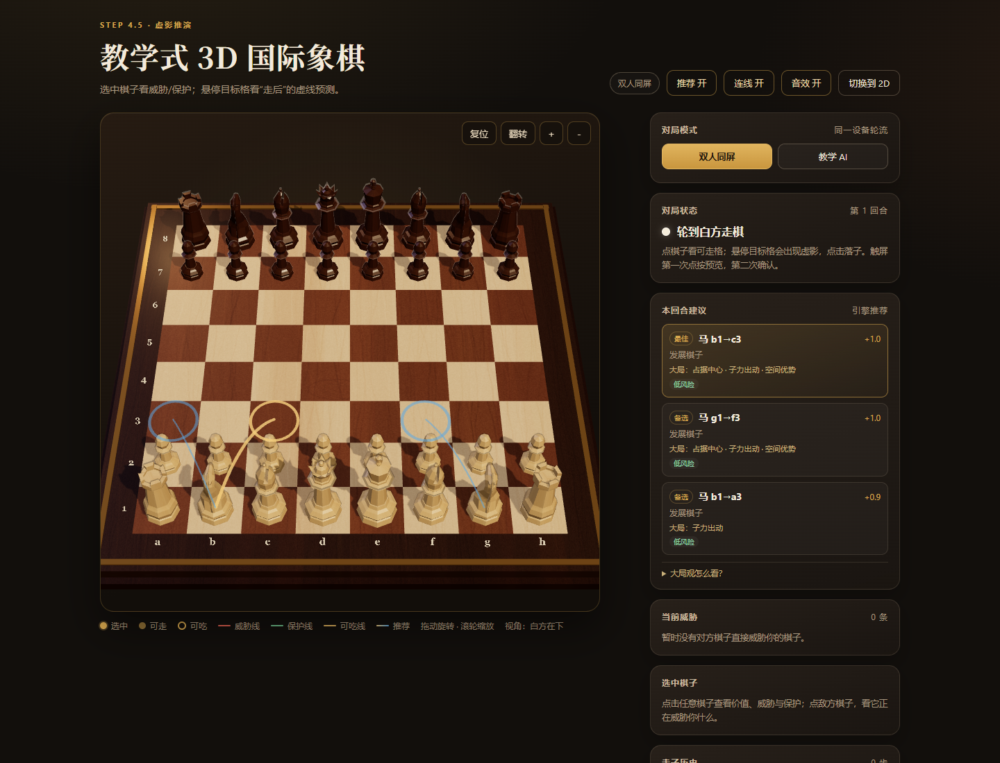
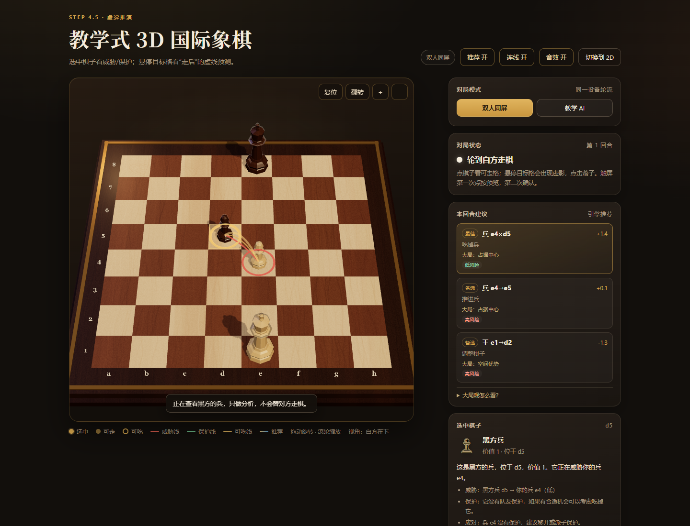
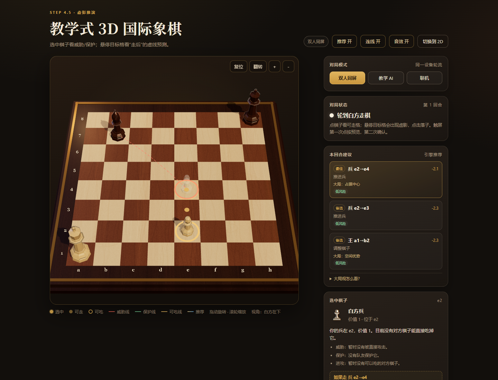
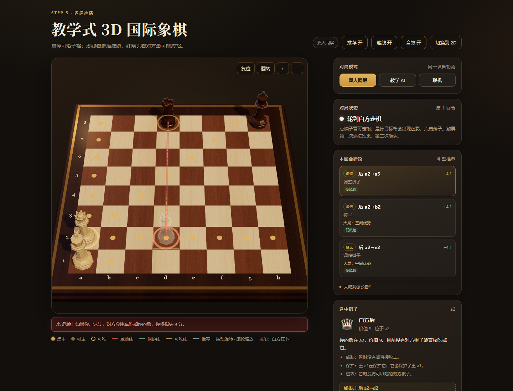
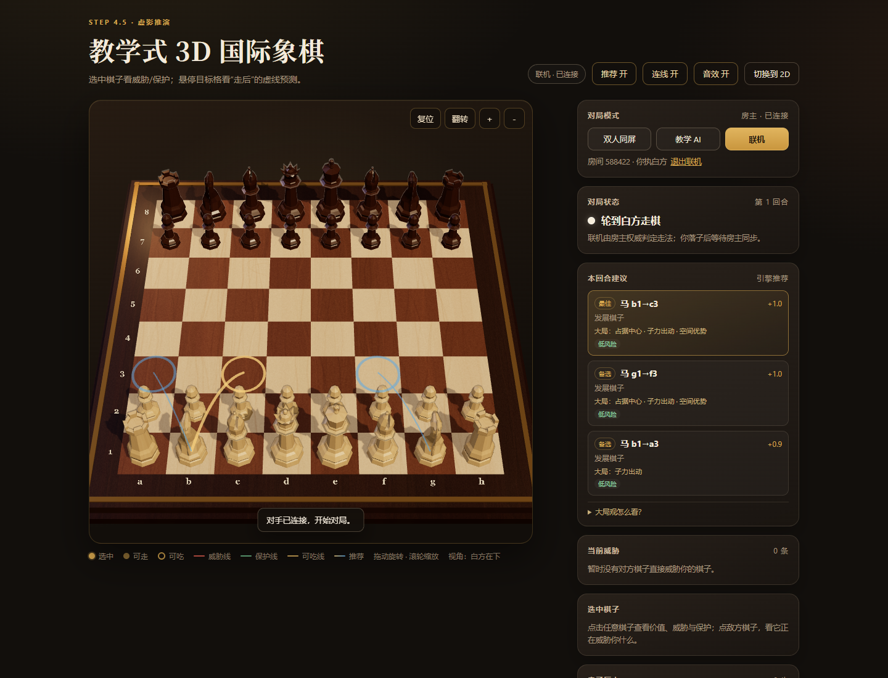
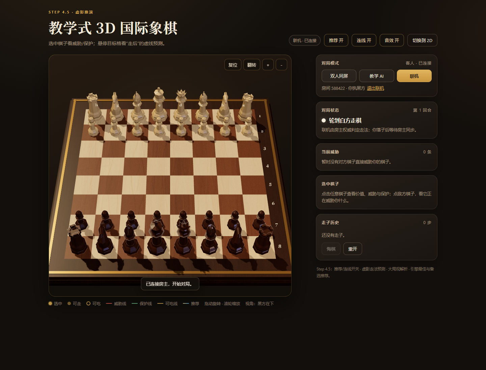

<h1 align="center">教学式 3D 国际象棋</h1>

<p align="center"><strong>不只是能下棋，还告诉你为什么。</strong></p>

<p align="center">
  <a href="https://chess-teaching-3d.netlify.app/">
    
  </a>
  
  
  
  
  
  
</p>

<p align="center">
  面向新手的教学式 3D 国际象棋：标准规则、多步推演、送子警告、教学 AI、<br/>
  威胁/保护连线、3D 木质棋盘，以及基于 PeerJS 的 P2P 联机。
</p>

<p align="center">
  <a href="https://chess-teaching-3d.netlify.app/">
    
  </a>
</p>

> A teaching-first 3D chess app for beginners: multi-move preview, blunder warnings, coaching AI, threat lines, and peer-to-peer online play.

## 为什么值得一玩

| 教学能力 | 说明 |
|---|---|
| 🧠 **多步推演** | 悬停一步棋，直接看到“你走 → 对方最可能怎么应 → 你接下来怎么走” |
| 🚨 **送子警告** | 臭棋不只说“不好”，而是直接说“对方会用车吃掉你的后，损失 9 分” |
| 🎯 **威胁 / 保护连线** | 只在选中棋子时出现，最多 3 条；红线威胁、金线可吃、绿线保护 |
| 🤖 **教学 AI** | 四档难度、执白/执黑、评估条、AI 每步解析 |
| 🌱 **大局观** | 占据中心、子力出动、王的安全、空间优势，不只盯着吃子 |
| 🌐 **P2P 联机** | 6 位房间号，PeerJS DataChannel，不需要游戏后端 |
| 🧱 **3D 木质棋盘** | GLB 棋子 + 程序化木纹 + 吃子倒地 + Web Audio 音效 |
| ✅ **规则可靠** | chess.js 唯一规则真源，68 项测试 + 深度 perft |

## 在线体验

👉 **https://chess-teaching-3d.netlify.app/**

打开即可下棋，不需要安装。联机时一人创建房间，另一人输入 6 位房间号。

**当前进度：Step 5 · 多步推演与纠错。** 规则内核、GLB 棋子、AI 对局继续保留；这一版把教学核心接上了：合法攻击图 + SEE、选中棋子才出现的威胁/保护连线、引擎最佳与备选推荐、己方/敌方棋子的通俗深度解析、“虚影走法预测”、多步推演与送子红字警告，以及 PeerJS P2P 联机。



| 玩家回合：最佳 + 备选推荐 | 点敌方棋子：它正在威胁谁 |
|---|---|
|  |  |

## 运行

```bash
pnpm install
pnpm dev        # http://127.0.0.1:5173
pnpm test       # 68 项规则 / 记谱 / 控制器 / 引擎 / 攻击图测试
pnpm perft      # 深度 perft：初始局面 197,281 + Kiwipete 97,862
pnpm build      # 类型检查 + 生产构建
```

## Step 4 已完成

### 1. 威胁与保护：只在选中时出现，最多 3 条

- **合法攻击图**：枚举双方所有合法吃子，区分“真威胁”和“只是控制”；被钉住的棋子不会产生假威胁。
- **SEE（静态交换评估）**：按子力价值和吃子顺序估算交换结果，威胁分为高/中/低，面板用“高/中/低”而不是引擎术语。
- **只画选中棋子相关的关系**，不铺满全盘：
  - **红线**：对方正在威胁我，或（点敌方时）它正在威胁我的哪些棋子。
  - **金线**：我能吃掉对方（可吃关系）。
  - **绿线**：队友在保护它。
- **最多 3 条**；超过时在面板写“还有 N 条关系未显示”，不会用线糊满棋盘。
- 威胁/保护线用**细管 + 端点圆环**，`depthTest: false` 保证不被棋子挡住；选中时优先展示关系，推荐只保留 1 条最佳箭头。

### 2. 推荐下法：引擎最佳 + 1–2 个备选

- 独立 Web Worker 跑 **MultiPV**（精确根着法评分），给当前行棋方返回前 3 条：1 条最佳 + 1–2 条备选。
- 每条推荐带 **1–2 个短理由**：`吃掉兵 · 控制中心`、`出子`、`王更安全`、`将军`、`升变`、`改善位置`。
- 显示**玩家视角的评分**和**风险等级**（与最佳着法的评分差）。
- 3D 棋盘：
  - **最佳推荐**：金色高弧箭头 + 终点圆环 + 呼吸光效。
  - **备选推荐**：蓝色细箭头，静态。
  - 点击右侧推荐卡可在棋盘上**预览**该走法（不自动落子）。
- 面板默认显示“分析中…”，算完再出结果；不会拿旧局面的推荐充数。

### 3. 点击棋子：己方/敌方都能看

- **己方棋子**：
  - 价值与位置；
  - 当前被谁威胁（红线、等级）；
  - 谁在保护它、它保护了谁（绿线）；
  - 它能吃谁（金线）；
  - 引擎前三里是否有它的推荐走法；没有就直说“没有进入前三”。
- **敌方棋子**：
  - 它正在威胁我的哪些棋子（红线）；
  - 它有没有队友保护；
  - 我应该“移开/保护被威胁的子”还是“可以考虑吃掉它”。
- 固定格式：**一句通俗总结 + 2–3 条要点**，不使用 PV、节点数、厘兵分等硬核术语。

### 4. 防糊屏规则

- 未选中棋子：只显示最多 3 条**推荐箭头**，不显示任何威胁线。
- 选中棋子：隐藏备选箭头，只留最佳箭头 + 最多 3 条相关关系线。
- AI 思考、落子动画、终局：清空连线和推荐箭头。
- 右侧威胁卡只列前 3 条，超出用文字计数。

## Step 4.5 交互增强

### 1. 两个独立视觉开关

顶栏新增：

- **推荐 开/关**：隐藏 3D 推荐箭头和右侧“本回合建议”卡；
- **连线 开/关**：隐藏选中棋子的威胁/保护/可吃连线和虚影预测线。

两个开关独立保存在 `localStorage`，刷新后保持；不改变规则和棋局。

### 2. 虚影上的动态威胁/保护线



- 鼠标悬停可落子格（或触屏第一次点按预览）时，不再只画一个半透明棋子：
  1. 用 `GameController.previewFen()` 复制棋局并试走一步；
  2. 对“走完后的局面”重新跑攻击图/SEE；
  3. 以虚影落点为目标，画出**虚线**：红=走后被威胁，金=走后能吃什么，绿=走后谁保护它。
- 虚线最多 3 条；面板同步显示“如果走这一步”的一句总结、走后的大局维度（如“占据中心”）和关系数量。
- 预测期间隐藏真实关系线和推荐箭头，避免“现在”和“走后”混在一起。
- 支持吃子、易位、吃过路兵；兵升变默认按“后”分析。

### 3. 大局观教学维度

推荐卡在战术理由之外增加一行 **“大局：…”**，来自 `strategy.ts` 的相对变化：

- **占据中心**：走到 d4/e4/d5/e5，或中心控制分数明显增加；
- **子力出动**：马/象离开原始底线；
- **王的安全**：易位、王回底线、兵盾改善；
- **空间优势**：己方合法走法总数明显增加。

示例：`马 b1→c3` 显示“调整棋子 / 大局：占据中心 · 子力出动 · 空间优势”，而不是只说“这步棋价值 +0.1”。

### 4. 核心逻辑中文注释

攻击图、SEE 递归、Negamax/Alpha-Beta、静态搜索、MultiPV、虚影预测和大局观评分都补了中文注释，重点解释“为什么这么写”和“新手容易误解什么”。

## Step 5 · 多步推演与纠错



### 触发方式

- 选中己方棋子后，鼠标悬停到可落子格（触屏第一次点按预览）；
- 虚影出现后，系统在后台推演：
  1. **你走这步**；
  2. **对方最可能的应招**；
  3. **你接下来最可能的一步**。

### 面板里的推演线

```text
推演：你 后 a2→d2 → 对方 车 d8×d2 → 你 王 a1→b1
对方最可能：车 d8×d2
危险！如果你走这步，对方会用车吃掉你的后，你将损失 9 分。
```

- 顶部用一句话总结“如果你走这步”，下面是对方应招和后续；
- 大局维度继续显示（如“占据中心”“空间优势”）；
- 如果对方应招会吃子，直接给出**被吃的棋子 + 子力价值**，例如“损失 9 分”；
- 评估下降达到阈值时，棋盘下方弹出**红色警告条**，同时面板红字提示；
- 轻微掉分用黄色“注意”，明显送子用红色“危险”。

### 3D 敌方箭头

- 对方最可能应招用**半透明红色粗箭头**画在棋盘上；
- 与自己的金色推荐箭头、红/绿/黄关系线区分；
- 只在虚影推演完成后出现，确认落子或移开鼠标即消失。

### 判断“臭棋”的方式

不是关键词硬猜，而是：

1. 引擎先算当前局面的最佳分；
2. 强制走候选着法后，让引擎给对手最佳应招；
3. `损失 = 最佳分 - 候选分`；
4. ≥1.5 分视为明显掉分，若还伴随被吃子，直接报出“对方用 X 吃掉你的 Y，损失 N 分”。

候选推演使用独立 Worker + 260ms 防抖 + 缓存，不会阻塞棋盘操作。

## 联机对战：PeerJS P2P（已实现）



| 房主执白 | 客人执黑，棋盘自动翻面 |
|---|---|
|  |  |

### 使用方式

1. 侧栏“联机” → “创建房间” → 选执白/执黑 → 得到 **6 位数字房间号**；
2. 朋友打开同一地址 → “联机” → “加入房间” → 输入房间号；
3. 连接成功后，房主执所选颜色，客人执另一色；客人棋盘自动翻到自己的方向；
4. 走子、悔棋、重开都通过 P2P DataChannel 同步；不需要 Node.js 后端。

### 实现架构

- **peerjs 1.5.5**：`PeerSession` 封装创建/加入、连接状态、错误和销毁；
- 房主 Peer ID 为 `chess-<6位房间号>`；撞号自动换号重试；
- **房主权威**：只有房主持有真实 `GameController`；客人发送 `move`，房主用 chess.js 校验后才应用；
- 房主应用后广播 `state`：`{ fen, records }`，客人用 `GameController.restore()` 恢复，不自行改棋局；
- 悔棋由客人发 `undo-request`，房主执行并广播；重开同理；
- 联机时禁用本地 AI；推荐/威胁分析仍在本机运行，不影响同步；
- 断线显示“对手已断开”，可退出联机回到双人同屏。

### 实测

- 两个独立的 Microsoft Edge 实例、两个独立的 PeerJS Peer；
- 创建房间 588422 → 客人加入；
- 房主 e2→e4，客人收到；客人 e7→e5，房主收到；
- 双方 FEN 一致：`rnbqkbnr/pppp1ppp/8/4p3/4P3/8/PPPP1PPP/RNBQKBNR w KQkq - 0 2`；
- 客人请求悔棋，房主执行后双方回到初始局面；
- 房主重开，双方历史清零。

### 已知限制

- 使用 PeerJS 公共云做 signaling；公共云故障/端口 443 被阻断时会连接失败；
- 少数对称 NAT 用户需要 TURN 中继，本项目暂未配置 TURN；
- 只有单房间、单对手；没有账号、房间密码或断线重连；
- 自动翻转 180° 只作为同设备兜底，本轮未启用（PeerJS 已可用）。

## Step 3 / 2.5 保留

### 教学 AI

- Web Worker Negamax + Alpha-Beta + 静态搜索 + 迭代加深；四档难度（深度 1–4）。
- 执白/执黑、AI 先行、评估条、AI 每步解析、输入锁、悔棋。
- AI 与推荐使用**独立 Worker**，推荐不会阻塞 AI 思考。

### 3D 棋子与吃子

- `GLTFLoader` 加载 `public/models/chess-set-pia.glb`，提取六种棋子几何体，归一化后套程序化木纹 + 凹凸 + clearcoat。
- 程序化棋子保留为加载失败兜底。
- 吃子沿 **攻击方 → 被吃子** 连线倒地，先倒后淡出，不朝镜头统一倒。

### 交互

- 鼠标：点己方棋子看可走格；悬停目标格出虚影；点击落子。
- 触屏：第一次点目标格预览，第二次确认。
- 点敌方棋子：进入“只分析、不替对方走棋”的查看模式。
- 2D 备用视图、WebGL 回退、升变、历史、重开、音效开关。

## 规则与测试

chess.js 1.4 是唯一规则真源：

- 王车易位、吃过路兵、兵升变、将军、将死、逼和、三次重复、五十回合、子力不足。
- **68 项测试**：规则、记谱、控制器、预览语义、引擎合法性/一步杀/MultiPV、多步推演/送子识别、攻击图、SEE、连线数量、推荐文案、虚影局面、联机消息协议。
- **深度 perft**：`pnpm perft` 验证初始局面 197,281、Kiwipete 97,862。
- 手工验证：选中己方/敌方、红/金/绿线、最多 3 条、推荐箭头呼吸、推荐预览、AI 执白/执黑。

## 目录

```text
src/
├─ domain/       # chess.js 封装、记谱、类型、预览
├─ engine/
│  ├─ search.ts  # 评估、Alpha-Beta、静态搜索、MultiPV、难度
│  ├─ worker.ts  # Web Worker 入口
│  └─ client.ts  # 主线程请求/中止封装
├─ analysis/
│  ├─ attackMap.ts    # 合法攻击图、SEE、威胁等级、棋子解析
│  ├─ strategy.ts     # 中心/出子/王安全/空间的大局观评分
│  ├─ recommend.ts    # 引擎根着法 → 推荐卡文案/风险
│  └─ connections.ts  # 选中棋子的 3D 连线（最多 3 条）
├─ three/        # 场景、GLB/木质棋子、棋盘、高亮/连线/箭头
├─ network/      # PeerJS 房间、消息协议、主机权威同步
├─ audio/        # Web Audio 三种音效
├─ ui/           # 棋盘画布、2D 备用视图、字符
├─ App.tsx       # 双人/AI/联机、推荐、解析、评估条
└─ styles.css
public/models/   # chess-set-pia.glb + 署名
tests/           # 规则/记谱/控制器/引擎/分析
```

## 已知限制

- 推荐使用固定深度 2 的精确 MultiPV（约 1 秒内），保证响应速度；不是 Stockfish 级别。
- SEE 是教学近似：保护关系按伪合法攻击计算，极少数被钉住的“保护”可能只是名义保护。
- 多步推演只到“你→对方→你”三层，不是完整变化树；深算仍受教学引擎强度限制。
- GLB 棋子是低多边形标准棋套，不是写实雕刻。
- 吃子已有沿攻击方向倒地 + 消融，但还没有木屑/碎裂粒子。

## 部署到 Netlify（当前线上）

线上地址：**https://chess-teaching-3d.netlify.app/**

1. Netlify → Add new site → Import an existing project；
2. 选择 GitHub 仓库 `cunzhuying/chess-teaching-3d`；
3. 构建配置读取根目录的 [netlify.toml](netlify.toml)：
   - Build command：`pnpm build`
   - Publish directory：`dist`
   - Node：22
4. Deploy。

之后每次 `git push` 到 `main`，Netlify 会自动部署。

## 部署到 Vercel

> 注意：部分网络会污染 `vercel.app` 域名，国内分享优先使用上面的 Netlify 地址。

项目已加 `vercel.json`，是纯静态 Vite 应用，不需要 API/后端。

### 方式 A：GitHub 导入（推荐给长期使用）

1. 把项目推到 GitHub；
2. Vercel → Add New → Project → 选择仓库；
3. Framework Preset 选 **Vite**；
4. Build Command：`pnpm build`；
5. Output Directory：`dist`；
6. Install Command：`pnpm install`；
7. Node.js 版本选 **22.x**；
8. Deploy。

`public/models/chess-set-pia.glb` 会被 Vite 自动复制到 `dist/models/`，PeerJS 也会一起打包，不需要额外配置。

### 方式 B：Vercel CLI

```bash
pnpm dlx vercel
pnpm dlx vercel --prod
```

首次运行按提示登录、关联项目；默认会读取 `vercel.json`。

### 部署后联机

- 你和朋友都打开 Vercel 的 HTTPS 网址；
- 一人“联机 → 创建房间”，把 6 位房间号发给对方；
- 对方“联机 → 加入房间”；
- PeerJS 的 WebRTC 数据不经过 Vercel；Vercel 只托管静态页面。

注意：公共 PeerJS Cloud 仍负责 WebRTC 握手；极少数对称 NAT 网络可能需要 TURN，本轮未配置。

## License

- **代码**：[MIT](LICENSE) © 2026 cunzhuying
- **棋子模型**：Pia Leung，CC BY 3.0；详见下方模型署名与 [public/models/ATTRIBUTION.md](public/models/ATTRIBUTION.md)

## 模型署名

- Chess Set by **Pia Leung**, via [Poly Pizza](https://poly.pizza/m/bfb3C6hpdi0), licensed under [CC BY 3.0](https://creativecommons.org/licenses/by/3.0/).
- 修改：仅提取六种棋子几何体，重新归一化尺寸/UV，并替换为程序化木质材质。详见 [public/models/ATTRIBUTION.md](public/models/ATTRIBUTION.md)。

## 下一步

1. **Step 5 · 多步推演与纠错**：玩家尝试走法后，展示“你走这步，对方最可能怎么应”，并对比推荐；错误走法给出可操作的纠正。
2. **联机增强**：断线重连、可选 TURN、房间密码（当前暂时冻结，优先教学）。
3. 之后再补开局原则、残局教学和视觉精修。
